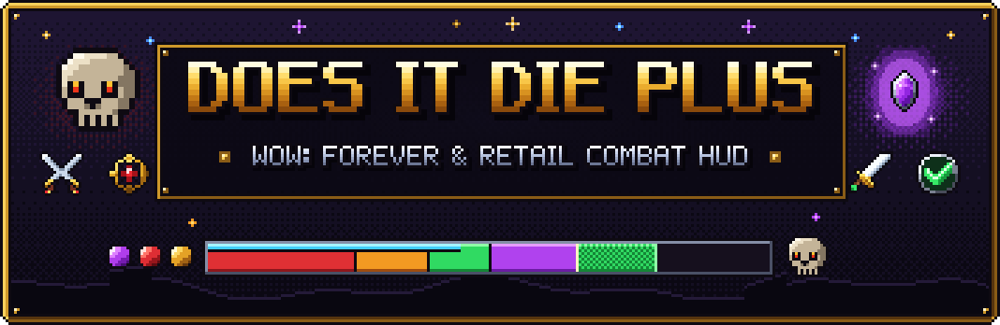
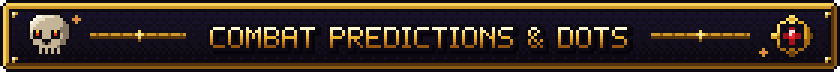
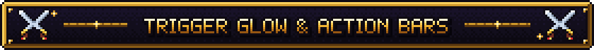
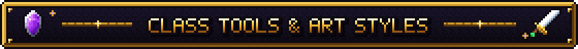
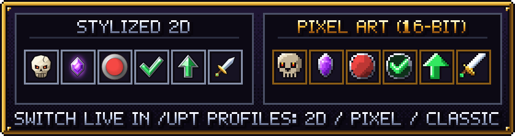
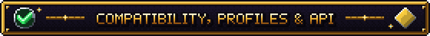
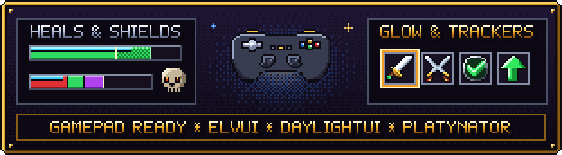

# DoesItDiePlus

_Formerly known as **Useful Plates and Tooltips**._

**DoesItDiePlus** is a standalone, modular combat HUD and tooltip suite built on top of the original [Does It Die](https://www.curseforge.com/wow/addons/does-it-die), expanded with cast and healing predictions, action bar numbers, reactive/lethal button glows, item upgrade evaluation, class resource & range tools, live art styles, and broad UI compatibility for **WoW: Forever** — plus an experimental **Retail (12.1.x)** test build (see [RETAIL.md](RETAIL.md)).

Every module can be toggled independently and configured live from `/upt` (or `/usefulplates`).

> **Active development & bug fixes:** Many bugs fixed continuously — if something does not work as expected, just ask or open an issue!

***

## Cast & Channel Prediction (`CastPrediction`)

Live damage markers on target, focus, party, raid, and nameplate health bars for direct casts and channeled damage spells across Mages, Warlocks, Balance Druids, Priests, Shamans, Hunters, and more:

*   Spell-power, talent tree, and aura-aware damage ranges with automatic non-crit hit calibration.
*   Shrinking real-time channel bar overlays (e.g., *Arcane Missiles*, *Mind Flay*), action-targeting (`softenemy`) support, **will-kill** skull/icon indicators, and automatic DoT-to-Cast kill suppression.

## DoTs, Bleeds & Poisons (`DoTInfo`)

Tracks your active DoTs on enemy nameplates and unit frames with remaining damage markers, kill indicators, and unified nameplate icon lanes:

*   **Rogues & Feral/Guardian Druids:** Tracks *Garrote*, *Rupture*, *Rake*, *Rip*, native **Lacerate** stacks, and all 5 ranks of *Deadly Poison* (plus Retail native poison/bleed aura overlays).

*   **Hunters & Priests:** Improved DoT tracking for Hunter traps and shots alongside native **Devouring Plague** segments for Priests.

*   **Customizable Looks:** Switch between **Juicy** and **Minimal** presets, **By effect type** / **Rainbow** / single-color DoT modes, and **77 built-in bar fill patterns** (plus Blizzard bar textures and `LibSharedMedia-3.0`).

## Shields & Incoming Heal Prediction (`ShieldsInfo` & `HealPrediction`)

*   **Shield Overlays (`ShieldsInfo`):** Remaining absorb amounts displayed cleanly across player, target, focus, group, and nameplate health bars (combat-safe with secret HP/absorb values).
*   **Incoming Heals (`HealPrediction`):** Client incoming-heal projection (`UnitGetIncomingHeals`), optional **All healers** band, targeted HoT estimates, and active **food/drink** health and mana projections on player, target, focus, target-of-target, party, and raid frames.

***

## Action Bar Numbers & Tooltip Details (`SpellDamageInfo`)

Displays predicted direct damage, DoT totals, healing, HoTs, absorbs, mana gains, and percentage self-heals directly on Blizzard, ElvUI, EllesmereUI, DaylightUI, Bartender4, and WoW: Forever native gamepad action bars — alongside tooltip breakdowns.

 

## Trigger Glow (`TriggerGlow`)

Lights up action bar buttons (Blizzard proc glow or pulsing border) at the right moment to execute a weakened target, heal an injured ally, react to a dodge/parry/block/kill, dispel/cure an effect, or land a lethal blow.

### Supported spells with their own rule

| Spell | Class | Type | Lit when |
| --- | --- | --- | --- |
| Execute | Warrior | Target health | Target at 20% health or less (adjustable) |
| Hammer of Wrath | Paladin | Target health | Target at 20% health or less (adjustable) |
| Divine Grace | Priest | Target health | Friendly target (not yourself) below 50% health (adjustable) |
| Overpower | Warrior | Reactive | After the target dodges |
| Revenge | Warrior | Reactive | After you block, dodge or parry |
| Victory Rush | Warrior | Reactive | Within 20 seconds after you kill an enemy that gives experience or honor |
| Mongoose Bite | Hunter | Reactive | After you dodge |
| Counterattack | Hunter | Reactive | After you parry |
| Dispel Magic | Priest | Dispel & cure | Friendly target has a Magic debuff, or enemy target has a Magic buff |
| Purge | Shaman | Dispel & cure | Enemy target has a Magic buff |
| Cure Disease / Abolish Disease | Priest / Shaman | Dispel & cure | Friendly target has a disease |
| Purify | Paladin | Dispel & cure | Friendly target has a disease or poison |
| Cleanse | Paladin | Dispel & cure | Friendly target has a disease, poison, or Magic debuff |
| Cure Poison / Abolish Poison | Druid / Shaman | Dispel & cure | Friendly target is poisoned |
| Remove Curse | Mage / Druid | Dispel & cure | Friendly target has a curse |

### Lethal damage: 65 spells

Lit while the spell's estimated damage is at least the target's current health. Uses the same damage estimate as the kill icon (*Cast prediction* must be on). All ranks of a spell share one switch.

| Class | Spells | Count |
| --- | --- | --- |
| Warrior | Execute, Hamstring, Intercept, Mocking Blow, Pummel, Shield Bash, Shield Slam, Thunder Clap | 8 |
| Paladin | Exorcism, Hammer of Wrath, Holy Shock, Holy Wrath | 4 |
| Hunter | Arcane Shot, Explosive Trap, Wing Clip | 3 |
| Rogue | Gouge, Kick | 2 |
| Priest | Chastise, Holy Fire, Holy Nova, Mind Blast, Mind Spike, Shadow Word: Death, Smite | 7 |
| Shaman | Chain Lightning, Earth Shock, Fire Nova, Flame Shock, Frost Shock, Lava Burst, Lightning Bolt | 7 |
| Mage | Arcane Barrage, Arcane Blast, Arcane Explosion, Arcane Surge, Arcane Wrath, Balefire Bolt, Blast Wave, Fire Blast, Fireball, Flamestrike, Frostfire Bolt, Ice Lance, Living Bomb, Pyroblast, Scorch, Spellfrost Bolt | 16 |
| Warlock | Chaos Bolt, Conflagrate, Death Coil, Immolate, Incinerate, Inferno, Searing Pain, Shadow Bolt, Shadowburn, Shadowflame, Soul Fire | 11 |
| Druid | Moonfire, Rake, Starfire, Starsurge, Sunfire, Swipe, Wrath | 7 |

Weapon attacks (Heroic Strike, Sinister Strike), finishers and spells whose tooltip the estimate cannot read have no damage estimate, so they are not listed. Priced spells the list does not know appear under *"Other spells found on your bars"* in the settings.

***

## Stats Comparison & Upgrade Arrows (`StatsInfo`)

*   **Detailed Tooltip Comparison:** Stat deltas against equipped gear, derived character gains (crit, hit, AP, spell power, etc.), ForeverSim-based spec ratings (**All**, **Automatic** by talent tree, or **Manual** role filters), item effects/procs, set bonuses, consumables (elixirs, flasks, food, potions, scrolls), hit/expertise caps, and optional Tank uncrittable/avoidance lines.
*   **Upgrade Badges Everywhere:** Green upgrade and red downgrade arrows across **bags** (with beneficiary spec icons), **loot / need-greed rolls / merchants**, and **quest rewards** (double arrow on the strongest upgrade, or a coin on the highest vendor sell choice when nothing upgrades).

 

***

## Art Style Switcher (`Stylized 2D` / `Pixel Art` / `Classic`)

Switch live anytime between **Stylized 2D**, **16-bit Pixel Art**, and **Classic** visuals for kill icons, Soul Shards, combo orbs, range medallions, upgrade arrows, and Hunter melee swords right in `/upt` → **Profiles** or via `/upt art 2d | pixel | classic`.

## Class-Specific Tools

*   **Resource Tracker (`ResourceDing`):** Visual trackers and customizable sounds for Rogue & Druid Combo Points, Warlock Soul Shards (Stylized 2D crystals, 16-bit Pixel Art gems, or Classic diamonds), plus Retail Holy Power, Chi, Arcane Charges, and Essence.
*   **Range Indicator (`Range`):** In-range checkmark and out-of-range cross on nameplates/target frames, with optional action bar icon desaturation while out of range.
*   **Hunter Range Finder (`HunterRangeFinder`):** Dedicated 7-segment Hunter distance ladder covering melee range, dead zone warnings, and ranged distance bands.

  

***

*   **Extensive UI Support:** Built-in integrations for *ElvUI, DaylightUI, HydraUI, EllesmereUI, Platynator, Plater, Threat Plates, X-Perl, Bartender4*, plus an interactive frame picker (`/upt frame` / `/upt pick`) for custom unit frames and nameplates.
*   **Taint-Free Gamepad Support:** Fully tested and designed for gamepad players (the author plays primarily on a gamepad!).
*   **Character & Named Profiles (`/upt profile`):** Use the shared *Default* profile, per-character profiles, or named profiles while keeping learned combat data and language intact.
*   **Multi-Language Support:** Interface available in English, German (`deDE`), and Russian (`ruRU`), with spell/DoT tooltip parsing across 8 client languages (`enUS`, `deDE`, `ruRU`, `frFR`, `esES`, `ptBR`, `zhCN`, `koKR`).
*   **Public Developer API ([API.md](API.md)):** Exposes `UsefulPlatesAndTooltips_API` (`DoT`, `CastPrediction`, `HealPrediction`, `SpellDamageInfo`, and `Frames` sources) so unit frame and nameplate addons can integrate seamlessly.

### Quick Slash Commands

*   `/upt` (or `/usefulplates`) — Toggle the settings window
*   `/upt art 2d | pixel | classic` — Switch icon & HUD art style live
*   `/upt profile` — Open Profiles or switch profiles (`list`, `char`, `default`, `use <name>`)
*   `/upt frame` / `/upt pick` — Inspect or interactively pick custom unit/plate frames
*   `/upt cast` · `/upt dot` · `/upt heals` · `/upt glow` · `/upt stats` · `/upt hunter` — Jump directly to module tabs
*   `/upt api` — Print public API versions and listener counts

***

## Video Showcase

***

## 📜 License

This project is licensed under **GPL-3.0-or-later**. See the [LICENSE](LICENSE) file for full details.

### Third-Party Credits

Certain modules use code from other fantastic projects and retain their original MIT notices:

*   **DoTInfo:** Based on [Does It Die](https://www.curseforge.com/wow/addons/does-it-die) by Joe Greive, featuring my custom updates and fixes (some ported back to the main project). _See `Modules/DoTInfo/LICENSE-DoesItDie.txt`._
*   **ShieldsInfo:** Adapted from [Shield Aura Forever](https://github.com/JasonEcks/ShieldAuraForever) by JasonEcks and contributors. _See `Modules/ShieldsInfo/LICENSE-ShieldAuraForever.txt`._
*   **SpellDamageInfo:** Options window adapted from _Does It Die_ by Joe Greive. _See `Modules/SpellDamageInfo/LICENSE-SpellDamageInfo.txt`._
*   **StatsInfo:** Stat weights derived from [ForeverSim](https://github.com/laurencestokes/foreversim) (MIT), built on [WoWSims](https://github.com/wowsims/forever) and Elliot Wood's Forever sim. _See `Modules/StatsInfo/LICENSE-ForeverSim.txt`._
*   **Resource Tracker & Range Indicator:** Integrated from my legacy addons.
